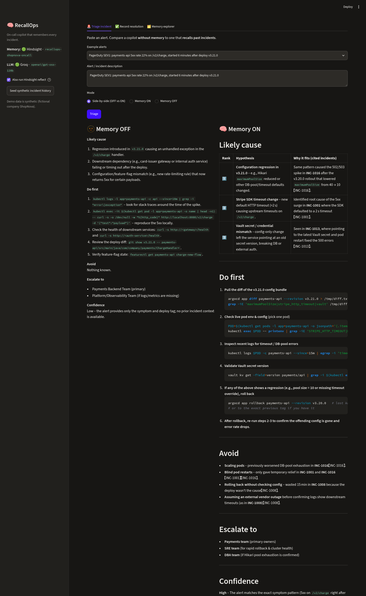
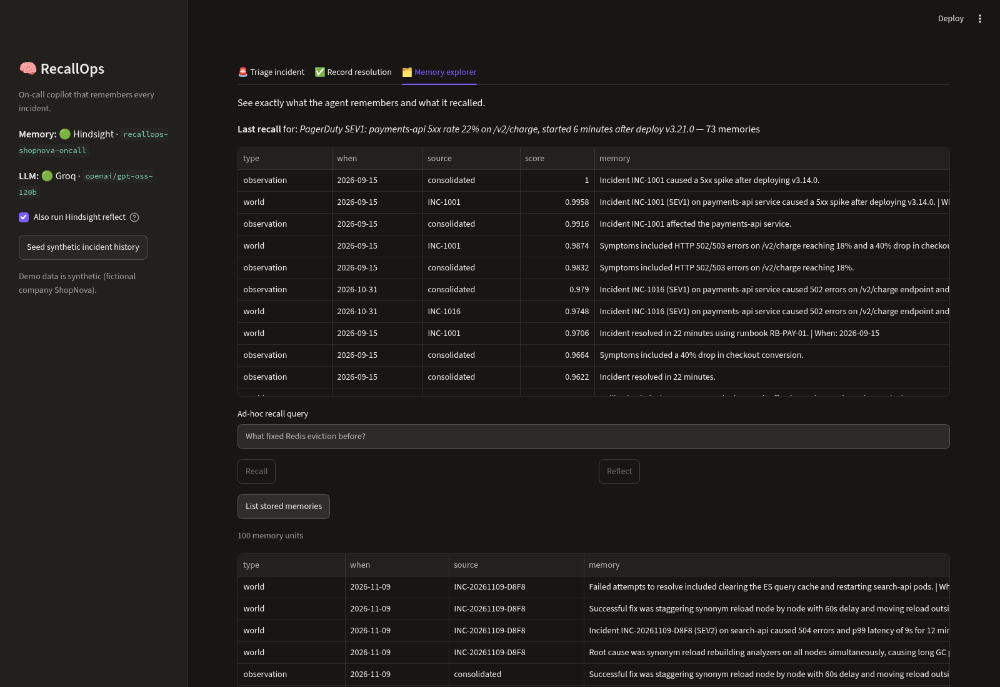
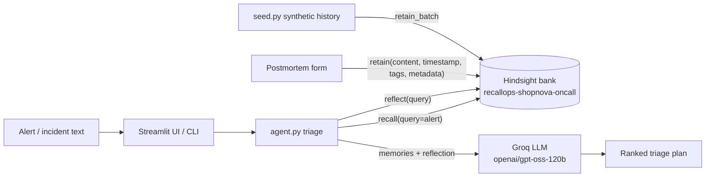

# RecallOps — the on-call copilot that remembers every incident

When an alert fires at 3 AM, the fix is often already known — it's buried in a postmortem
nobody remembers, or in the head of an engineer who is asleep. **RecallOps** gives the
on-call engineer a ranked triage plan grounded in the team's own incident history, using
[Hindsight](https://github.com/vectorize-io/hindsight) as long-term agent memory.

- **Recall**: a new alert pulls up similar past incidents — root causes, fixes that worked,
  fixes that *failed*, runbooks and teams involved.
- **Reflect**: Hindsight reasons over the whole bank to summarise what usually causes this and what to avoid.
- **Retain**: after resolution, the engineer records what actually happened; the next similar alert gets a better answer.
- **Memory OFF vs ON**, side by side, so the difference memory makes is obvious.

> Demo data is **synthetic**: 18 fictional incidents at "ShopNova", a made-up e-commerce company.

## The problem

On-call teams repeat the same mistakes. Postmortems get written and never read. A generic LLM
copilot doesn't help: with no history it can only say "check recent deploys, look at dashboards",
and it will happily suggest the exact fix that wasted 20 minutes last month (e.g. *scaling pods*
for a connection-pool bug). The knowledge exists — it just isn't *remembered* at the moment it matters.

## Before / after (real run)

Alert: `PagerDuty SEV1: payments-api 5xx rate 22% on /v2/charge, started 6 minutes after deploy v3.21.0`
— same Groq model (`openai/gpt-oss-120b`), same prompt; the only difference is Hindsight recall + reflect.
Output trimmed from a live run of `python cli.py compare "..."` against Hindsight Cloud:

| Memory OFF | Memory ON (Hindsight) |
|---|---|
| **Likely cause:** "Regression introduced in `v3.21.0` causing unhandled exceptions in the `/v2/charge` handler." | **Likely cause:** "Configuration regression introduced in v3.21.0 – e.g., Hikari `maximumPoolSize` reduced (as in INC‑1016)", then a Stripe SDK timeout change (INC‑1001) and a stale Vault secret (INC‑1013). |
| **Do first:** grep the pod logs, `git diff v3.20.0..v3.21.0`, check downstream health. | **Do first:** `argocd app diff`, check `maximumPoolSize`, `STRIPE_HTTP_TIMEOUT` and the Vault secret version, then `argocd app rollback payments-api`. |
| **Avoid:** generic advice ("blindly increasing replica count…"). | **Avoid:** "Scaling the payments‑api pods (worsened DB pool exhaustion in INC‑1016)", "Blind pod restarts (only gave temporary relief in INC‑1001 & INC‑1016)". |
| **Confidence:** "Low – no prior incident data". | **Escalate to:** payments, SRE, **DBA**. **Confidence:** "Medium – … matches several recent config-related regressions (INC‑1016, INC‑1001, INC‑1013)". |



**Learning loop (real run):** for a never-seen alert, `loyalty-points service returns 500 when tier recalculation job runs`,
Memory ON only found loosely related incidents (DB pool exhaustion, Redis eviction, a bad feature flag). After one postmortem was
retained through `agent.record_resolution()`, the very next recall (no waiting needed) returned the new incident as its top
memories, and the plan led with *"Postgres lock contention on `points_ledger` … (see INC‑20261109‑71C2)"* and the
replica + batched-writes fix, warning against restarting pods.



## Architecture



| File | Role |
|---|---|
| `memory.py` | The only module that talks to Hindsight (`retain_batch`, `recall`, `reflect`, `list_memories`, `create_bank`), plus an offline in-memory fallback with the same interface |
| `llm.py` | Groq via its OpenAI-compatible API, with retries/back-off, `<think>` stripping and clear errors |
| `agent.py` | Triage logic (memory ON/OFF), graceful fallbacks, postmortem validation + retain |
| `app.py` | Streamlit UI: Triage (side-by-side), Record resolution, Memory explorer |
| `seed.py` / `incidents_data.py` | 18 synthetic past incidents spread over ~8 weeks |
| `cli.py` | `triage` and `compare` from the terminal |
| `tests/` | 24 unit tests with fake Hindsight / fake LLM clients (no keys needed) |

## How Hindsight memory is used

RecallOps uses the official Python SDK [`hindsight-client`](https://pypi.org/project/hindsight-client/) (v1.2.0)
against **Hindsight Cloud** (`https://api.hindsight.vectorize.io`, Bearer API key). Docs: <https://hindsight.vectorize.io/>.

### Bank design
- **One bank per on-call organisation**: `recallops-shopnova-oncall` (`HINDSIGHT_BANK_ID`). Every postmortem from every
  service goes into the same bank so Hindsight can link entities across incidents (e.g. "payments-api", "Hikari", "argocd").
- The bank is configured once with `create_bank(bank_id, retain_mission=..., reflect_mission=...)`:
  - **retain_mission** tells extraction what matters: service, symptoms, root cause, fix that worked,
    fix that did *not* work, teams, runbooks, time to resolve, and to keep exact technical names.
  - **reflect_mission** makes reflect behave like a senior SRE: cite incident IDs, prefer fixes that worked, warn about ones that failed.

### What gets stored (retain)
Each resolved incident becomes one memory item (`memory.py::_item`):

```python
client.retain_batch(bank_id=bank, items=[{
    "content": incident.to_memory_text(),     # narrative postmortem: symptoms, root cause, worked, failed, teams, runbook
    "timestamp": incident.occurred_at,        # when it happened -> temporal recall ("last month's payments outage")
    "context": "postmortem for payments-api incident",
    "document_id": "INC-1016",                # one document per incident, so it can be updated/replaced
    "metadata": {"incident_id": ..., "service": ..., "severity": ..., "title": ...},
    "tags": ["service:payments-api", "severity:sev1", "kind:postmortem", "team:payments", "team:dba"],
}])
```

Hindsight extracts typed facts and entities from this text and links them; its background
consolidation turns repeated patterns (e.g. "scaling pods didn't fix payments 5xx") into **observations**.
Retain happens in two places: `seed.py` (history) and the **Record resolution** tab (new postmortems — the learning loop).

### Recall (every Memory ON triage)
```python
client.recall(bank_id=bank, query=alert_text,
              types=["world", "experience", "observation"], max_tokens=2048, budget="mid")
```
Hindsight runs semantic + keyword + graph + temporal retrieval, reranks, and fills a 2,048-token budget.
The recalled facts (with dates and source incident IDs) are injected into the LLM prompt and shown in the
UI's "memories recalled" panel and the **Memory explorer**.

### Reflect (optional, on by default)
```python
client.reflect(bank_id=bank, query="An alert just fired: '<alert>'. What most likely caused it, what fixed it before, what should on-call avoid?", budget="low")
```
Reflect runs Hindsight's agentic reasoning loop over the bank (guided by `reflect_mission`) and returns a
grounded summary, which is shown to the engineer and also passed to the LLM.

### Memory OFF
The same agent and prompt, but `recall`/`reflect` are skipped — that is the "before" in the demo.

## Setup

```bash
git clone https://github.com/Madhan-raj-k/recall-ops.git && cd recall-ops
python -m venv .venv && source .venv/bin/activate      # Windows: .venv\Scripts\activate
pip install -r requirements.txt
cp .env.example .env     # then fill in the keys
```

- **Hindsight API key**: sign up at <https://ui.hindsight.vectorize.io>, create an API key (`hsk_...`), put it in `HINDSIGHT_API_KEY`.
- **Groq API key**: <https://console.groq.com/keys> → `GROQ_API_KEY`. Model defaults to `openai/gpt-oss-120b` (`qwen/qwen3-32b` also works).

```bash
python seed.py            # retain 18 synthetic incidents into your bank (python seed.py --dry-run to preview)
streamlit run app.py      # open http://localhost:8501
python -m pytest          # 24 tests, no keys needed
```

No keys yet? `streamlit run app.py` and `python cli.py --offline compare "payments-api 5xx after deploy"` still work using
an in-memory keyword store seeded with the same synthetic incidents (clearly labelled "offline" in the UI).

## Demo walkthrough

1. **Triage tab** → pick the example *"payments-api 5xx … after deploy v3.21.0"* → **Side-by-side** → **Triage**.
   Left (OFF): a generic checklist. Right (ON): the incidents it recalled, the fix that worked (`argocd app rollback`, check Hikari pool),
   and an explicit **Avoid: scaling pods**.
2. Expand **memories recalled** / **Hindsight reflect** to show exactly what came from memory.
3. Type a brand-new alert the bank has never seen, e.g. *"loyalty-points 500s when tier recalculation job runs"* → Memory ON finds only loosely related incidents and says confidence is low.
4. **Record resolution** tab → enter the postmortem (root cause: the job locks the points table; fix: run it on the replica and batch updates; didn't work: restarting pods) → **Retain**.
5. Back to Triage with the same alert → Memory ON now recommends the replica/batching fix and warns against restarting pods. That's the learning loop.
6. **Memory explorer** → ad-hoc `recall` / `reflect` queries and a list of stored memory units.

## Edge cases handled
- Hindsight down or rejecting requests → triage continues without memory and shows a warning; bank configuration failures are non-fatal.
- LLM missing, rate-limited (429), timing out or returning empty output → retries with back-off, then a deterministic plan built from recalled memories.
- Empty alerts are rejected; postmortems require title, service, root cause and fix; negative durations rejected; service names normalised.
- Secrets only come from environment variables / `.env` (git-ignored).

## Limitations
- Memory quality depends on postmortem quality: a vague "restarted stuff, it worked" teaches very little.
- Similar symptoms can have different causes (three different payments 5xx root causes in the demo data). RecallOps ranks hypotheses, it does not prove one — the engineer still verifies.
- Recall returns many small extracted facts (60–90 for the payments alert in our runs). The agent sends the top 30 to the LLM and shows all of them in the UI.
- Observations are consolidated in the background, so they can lag behind raw facts; in our runs the new postmortem's raw facts were recallable immediately.
- A Memory ON triage with reflect takes roughly 10–20 s (recall + reflect + LLM), which is fine for triage but not instant.
- The offline fallback is simple keyword overlap, only for keyless demos; the real retrieval quality comes from Hindsight.
- No live integrations yet (PagerDuty, Slack, Grafana); alerts are pasted in.

## Learn more
- Hindsight on GitHub: <https://github.com/vectorize-io/hindsight>
- Hindsight docs: <https://hindsight.vectorize.io/>
- What is agent memory? <https://vectorize.io/what-is-agent-memory>

## Team
Madhan Raj and Faraz. MIT licensed.
